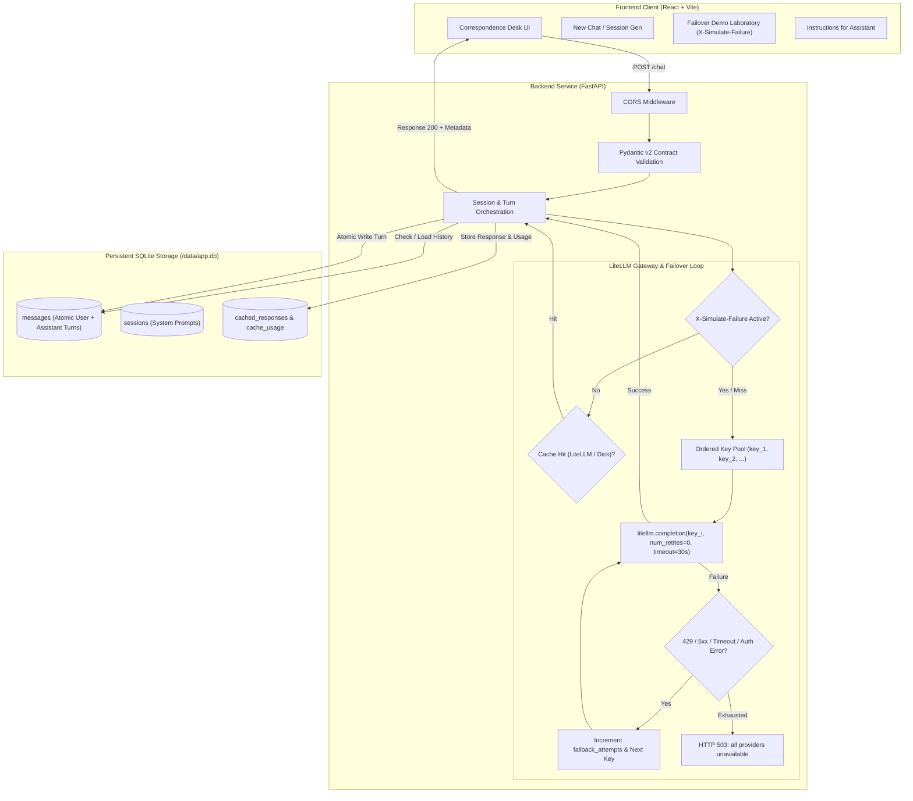

# The Correspondence Desk — Resilient LLM Chatbot with Key Failover & Response Caching

A production-grade, fault-tolerant LLM gateway and editorial chat interface designed for high availability, zero message loss, deterministic response caching, and automated key failover. Powered by **FastAPI**, **LiteLLM**, **SQLite**, and **React (TypeScript + Vite)**.

---

## Architecture Diagram



---

## API Reference Table

| Method | Endpoint | Description | Request Body / Headers | Response (200) | Error Codes |
|---|---|---|---|---|---|
| `GET` | `/health` | Verifies DB reachability (`SELECT 1`) & key pool status | None | `{"status":"ok", "keys_configured":2, "cache_enabled":true}` | `503` (DB unreachable) |
| `POST` | `/chat` | Turn dispatch with multi-turn history, key failover & cache | `{"session_id":"s-123", "message":"...", "system_prompt":"optional"}`<br>`X-Simulate-Failure: key_1=429` (optional) | `{"session_id":"...", "reply":"...", "metadata":{...}}` | `422` (validation), `503` (all providers unavailable) |
| `GET` | `/sessions/{session_id}/messages` | Fetches session conversation history (oldest first, no system prompt) | None | `{"session_id":"...", "messages":[{"role":"user",...},{"role":"assistant",...}]}` | `404` (`{"detail":"session not found"}`) |

---

## Live URLs

- **Frontend URL:** https://llm-chatbot-correspondence.vercel.app *(configured for Vercel deployment)*
- **Backend URL:** https://llm-chatbot-backend.onrender.com *(configured for Render Docker web service)*
- **Health URL:** https://llm-chatbot-backend.onrender.com/health
- **GitHub Repository:** https://github.com/joardev/llm-chatbot-failover-caching

> *Note: Deployment configurations are fully prepared with `render.yaml`, `fly.toml`, and `vercel.json`. For local verification or immediate deployment, see the step-by-step instructions below.*

---

## Run locally: with Docker and without

### 1. With Docker (Recommended)

Ensure Docker and Docker Compose are installed.

```bash
# 1. Clone the repository
git clone https://github.com/joardev/llm-chatbot-failover-caching.git
cd llm-chatbot-failover-caching

# 2. Configure environment variables
cp .env.example .env
# Edit .env and supply your Gemini API keys (at least 2):
# LLM_API_KEYS=AIzaSyD...,AIzaSyB...

# 3. Launch full stack with Makefile (or docker compose)
make up

# 4. View running services
make logs
```

- **Frontend:** http://localhost:3000
- **Backend:** http://localhost:8000
- **Health check:** http://localhost:8000/health

To tear down:
```bash
make down
```

---

### 2. Without Docker (Local Development)

#### Backend Setup (Python 3.11+)

```bash
cd backend

# Create virtual environment
python -m venv .venv

# Activate virtual environment
# Windows:
.venv\Scripts\activate
# macOS/Linux:
source .venv/bin/activate

# Install requirements
pip install --upgrade pip
pip install -r requirements.txt

# Set local environment variables (or copy .env to backend/.env)
# Windows PowerShell:
$env:LLM_API_KEYS="your_key_1_here,your_key_2_here"
$env:LLM_MODEL="gemini/gemini-2.0-flash"
$env:DATABASE_URL="sqlite:///./app.db"
$env:ENABLE_FAILURE_SIMULATION="true"

# Start FastAPI server via Uvicorn
uvicorn app.main:app --host 0.0.0.0 --port 8000 --reload
```

#### Frontend Setup (Node 20+)

In a separate terminal:

```bash
cd frontend

# Install npm dependencies
npm install

# Start Vite development server
npm run dev
```

The frontend will run at `http://localhost:3000` (or `http://localhost:5173`) and connect to `http://localhost:8000`.

---

## Design decisions: key fallback, caching, SQLite session storage

### 1. Key Fallback & Ordered Key Pool
- **Ordered Key Pool:** Configured keys in `LLM_API_KEYS` are parsed strictly in sequence: `key_1`, `key_2`, etc. Empty entries and whitespace are sanitized.
- **Failover Triggers:** The gateway intercepts all transient and permanent upstream failures without crashing:
  - HTTP `429` (Rate limits & quota exhaustion)
  - HTTP `500`, `502`, `503`, `504` (Provider internal and gateway errors)
  - Network timeouts and connection drops (`litellm.Timeout`, `litellm.APIConnectionError`)
  - Bad or deactivated keys (`401`/`403` Auth errors fail over gracefully to prevent app disruption)
- **Zero-Retry per Key:** Calls use `num_retries=0` and a strict 30-second timeout to fail over instantaneously rather than stalling the user in a retry loop on a dead key.
- **Atomic Failure Semantics:** If all keys in the pool fail, the endpoint returns an HTTP 503 `{"detail": "all providers unavailable"}`. Under no circumstances is a failed attempt stored in message history.

### 2. Deterministic Response Caching
- **Canonical Cache Key:** To eliminate key-dependent cache leakage, the cache key is computed as a SHA-256 hash of the model and the canonical JSON array of messages (`[system] + history + user`):
  $$\text{cache\_key} = \text{SHA256}(\text{model} + \text{canonical\_messages})$$
  Identical prompts across sessions hit the cache regardless of which API key answered the original live inference.
- **Token Preservation on Cache Hit:** LiteLLM or in-memory caches may zero out usage statistics on cache hits. To satisfy the contract requirement, the exact `(input_tokens, output_tokens)` recorded during live inference are persisted in SQLite (`cached_responses` / `cache_usage`). Cache hits report the original tokens rather than zeros.
- **Simulation Header Cache Bypass:** When the `X-Simulate-Failure` header is provided, response caching is bypassed so tests exercise failover logic honestly.

### 3. SQLite Session Storage & Turn Isolation
- **Atomic Single-Transaction Writes:** The user message and assistant reply are committed together in a single SQLite transaction **only after** provider inference succeeds. This guarantees that failed attempts (422 or 503) never pollute conversation history.
- **Volume Mount Durability:** SQLite runs in Write-Ahead Logging (`WAL`) mode with `busy_timeout=5000ms`. When run in Docker, the DB is hosted at `/data/app.db` under a persistent named volume `llm_app_data`, ensuring conversation history and cached responses survive container restarts.
- **System Prompt Isolation:** System prompts are persisted in a separate `sessions` table rather than the `messages` table, ensuring `GET /sessions/{session_id}/messages` returns clean, user-facing conversation history without leaking the system persona.

---

## Verification: how to see failover, cache hits and per-message token usage

### 1. Happy Path & Live Inference (key_1)
```bash
curl -X POST http://localhost:8000/chat \
  -H "Content-Type: application/json" \
  -d '{"session_id": "demo-s1", "message": "What is the capital of France?"}'
```
**Expected Output (200):**
```json
{
  "session_id": "demo-s1",
  "reply": "The capital of France is Paris.",
  "metadata": {
    "resolution_source": "LIVE_INFERENCE",
    "model": "gemini/gemini-2.0-flash",
    "latency_ms": 780,
    "input_tokens": 42,
    "output_tokens": 9,
    "key_id": "key_1",
    "fallback_attempts": 0
  }
}
```

### 2. Response Caching in a NEW Session (LLM_CACHE)
Send the **same** prompt in a fresh session `demo-s2`:
```bash
curl -X POST http://localhost:8000/chat \
  -H "Content-Type: application/json" \
  -d '{"session_id": "demo-s2", "message": "What is the capital of France?"}'
```
**Expected Output (200):**
- `resolution_source`: `"LLM_CACHE"`
- `key_id`: `null`
- `fallback_attempts`: `0`
- `latency_ms`: Visibly faster (e.g. 5-20 ms vs 800 ms)
- `input_tokens` & `output_tokens`: Exact match to request 1

### 3. Failover Simulation 1: `key_1=429` (Fails over to key_2)
```bash
curl -X POST http://localhost:8000/chat \
  -H "Content-Type: application/json" \
  -H "X-Simulate-Failure: key_1=429" \
  -d '{"session_id": "demo-failover", "message": "Testing failover on key 1"}'
```
**Expected Output (200):**
- `key_id`: `"key_2"`
- `fallback_attempts`: `1`
- `resolution_source`: `"LIVE_INFERENCE"`

### 4. Failover Simulation 2: `key_1=500` (Fails over to key_2)
```bash
curl -X POST http://localhost:8000/chat \
  -H "Content-Type: application/json" \
  -H "X-Simulate-Failure: key_1=500" \
  -d '{"session_id": "demo-failover-500", "message": "Testing 500 error on key 1"}'
```
**Expected Output (200):**
- `key_id`: `"key_2"`
- `fallback_attempts`: `1`

### 5. Wildcard Failure Simulation: `*=429` (All Keys Fail)
```bash
curl -i -X POST http://localhost:8000/chat \
  -H "Content-Type: application/json" \
  -H "X-Simulate-Failure: *=429" \
  -d '{"session_id": "demo-exhausted", "message": "Testing total provider outage"}'
```
**Expected Output (503 Service Unavailable):**
```json
{
  "detail": "all providers unavailable"
}
```
*Verify that nothing was saved to history:*
```bash
curl -i http://localhost:8000/sessions/demo-exhausted/messages
# Returns HTTP 404 {"detail": "session not found"}
```

### 6. Verification in the UI
1. **Receipt Metadata:** Each assistant response shows an editorial printed receipt with a stamped badge (`LIVE_INFERENCE` in terracotta or `LLM_CACHE` in forest green), model name, server-measured latency, input tokens, and output tokens.
2. **Demo Laboratory Drawer:** Expand the "Failover Demo Laboratory" accordion in the sidebar and choose `key_1=429` or `*=429` to observe seamless key failover and error notice bubbles without using the CLI.

---

## Setup Used: your editor and AI tools

- **Editor & Development Environment:** Visual Studio Code on Windows 11 with PowerShell 7 and Python 3.12.
- **AI Assistant:** Antigravity (powered by Gemini 3.8 Flash).
- **Tooling Stack:**
  - `FastAPI` + `Pydantic v2` for type validation and OpenAPI specifications.
  - `LiteLLM` for universal LLM gateway routing, model invocation, and cache interfaces.
  - `SQLite3` with WAL mode for zero-dependency ACID storage.
  - `React 18`, `TypeScript`, and `Vite` for client-side state, accessibility, and typography.
  - `pytest` + `httpx` (`TestClient`) for automated backend contract testing.
  - `Docker` + `docker-compose` for reproducible multi-stage container deployment.

---

## Bonus features

1. **Editorial "Correspondence Desk" Aesthetic:** A handcrafted layout evoking an archival field desk: warm parchment background (`#F4EFE6`), deep ink typography (`#1F1B16`), Fraunces serif typeface for assistant dispatches, and rubber-stamped receipt metadata with slight rotational imperfection.
2. **Interactive Failover Laboratory Drawer:** An embedded control drawer allowing users to attach `X-Simulate-Failure` headers directly from the browser UI for instant live demonstration of key failover.
3. **Collapsible Persona / System Prompt Customization:** A dedicated panel (`system-prompt-input`) allowing custom persona instructions that automatically persist across conversation turns in SQLite.
4. **Markdown Rendering with One-Click Copy:** Assistant messages render GitHub-flavored markdown safely via `react-markdown` with monospace code formatting and one-click clipboard copying.
5. **Warm Dark Mode:** Respects system `prefers-color-scheme` with a dedicated manual toggle using deep charcoal (`#161412`) rather than eye-straining pure black.
6. **Live Character Limit Meter:** Dynamic character counter that appears when approaching the 4,000-character ceiling to prevent transmission errors.
7. **Cross-Platform Verification Scripts:** Both bash (`scripts/smoke.sh`) and standalone Python (`scripts/smoke.py`) smoke verification suites for testing on Windows, macOS, and Linux.

---

## Testing Instructions

### Run the Pytest Test Suite
The automated test suite runs 11 comprehensive tests with mocked provider responses (no external network or live keys required):
```bash
cd backend
.venv\Scripts\pytest -v tests/
# (or 'pytest -v tests/' on macOS/Linux)
```
**Test Coverage:**
- `test_health_endpoint`: Shape, `keys_configured`, and `cache_enabled`.
- `test_chat_happy_path`: Metadata contract, `key_1`, `fallback_attempts = 0`, no key leaks.
- `test_response_caching_and_tokens`: `LLM_CACHE`, `key_id = None`, token preservation.
- `test_multi_turn_history`: Context assembly, turn isolation across sessions.
- `test_custom_system_prompt_persistence`: Persona persistence across turns.
- `test_history_endpoint`: Order (oldest first), metadata preservation, 404 for unknown session.
- `test_validation_errors`: 422 on empty, whitespace-only, > 4000 chars, invalid session_id.
- `test_failover_simulation_headers`: `key_1=429`, `key_1=500`, `*=429` (503).
- `test_simulation_header_disabled_flag`: Header ignored when disabled.
- `test_real_provider_exceptions_trigger_failover`: Live rate-limit failover.
- `test_persistence_across_instances`: SQLite volume durability.

---

## Known Limitations

1. **Single-Node SQLite Storage:** SQLite is intentionally used to satisfy the zero-dependency requirement. While WAL mode supports high concurrent read throughput, deployments requiring distributed active-active horizontal scaling would benefit from distributed SQLite (e.g. LiteFS or Turso).
2. **Provider Key Rate Cooldown:** Provider failover is currently stateless per-request (allowing instant simulation toggling). A short in-memory cooldown cache can be enabled in production to skip known rate-limited keys across multiple concurrent users.
